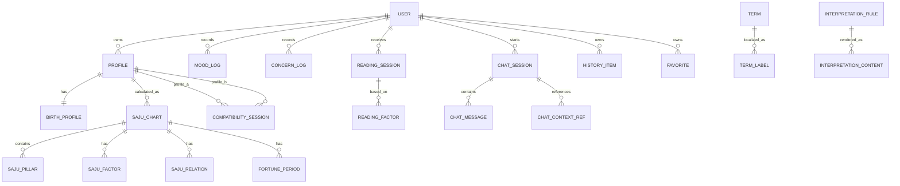

# 모나(MONA) 데이터 모델 + DB Schema v1.0

**문서 상태:** Logical Data Model / SQLite-First Reference Schema  
**기준 문서:** `mona_handoff.md`, `MONA_사주계산엔진_설계_v1.0.md`, `MONA_다국어_용어표준집_v1.0.md`, `MONA_앱_IA_화면명세_v1.0.md`  
**목표:** MVP를 로컬 DB로 시작해도 향후 서버 동기화·다국어·Rule Versioning으로 확장할 수 있는 데이터 구조를 정의한다.

---

# 1. 설계 원칙

모나의 데이터는 네 계층으로 분리한다.

```text
A. Personal Data
   사용자 / 프로필 / 출생정보 / 감정 / 고민 / 상담 / 히스토리

B. Derived Saju Data
   사주 원국 / 오행 / 십신 / 관계 / 대운 / 세운 / 운세 Factor

C. Shared Content
   용어 표준 / 번역 / Interpretation Rule / 타로 / 꿈 / Color / Gem / 부적

D. Ephemeral Data
   관상용 원본 얼굴 사진 등 영구 저장하지 않는 데이터
```

핵심 원칙:

1. **개인 데이터와 공용 콘텐츠를 분리**한다.
2. 계산엔진은 번역 문자열을 저장하지 않고 **canonical ID**만 저장한다.
3. 모든 핵심 계산 결과에 **Rule Version**을 남긴다.
4. 사용자 히스토리는 가능하면 **append 중심**으로 관리한다.
5. 얼굴 원본 사진은 기본 DB에 영구 저장하지 않는다.
6. SQLite에서 시작해도 서버 PostgreSQL로 옮기기 쉽게 `TEXT UUID` 식별자를 사용한다.
7. 날짜/시간은 UTC 저장을 기본으로 하고, 출생시각처럼 지역시간 자체가 의미 있는 데이터는 local 값과 timezone을 함께 저장한다.
8. 다국어 문자열은 `term_id` / `resource_key` 기반으로 관리한다.
9. AI 대화는 필요한 Context만 참조하고 원본 민감정보를 불필요하게 중복 저장하지 않는다.
10. 삭제 가능한 사용자 데이터와 변경 불가능한 계산/콘텐츠 버전을 구분한다.

---

# 2. DB 구성 권장안

MVP에서는 하나의 SQLite DB로 시작할 수 있지만 논리적으로는 다음 영역을 구분한다.

```text
mona.db
├─ user_*          개인/프로필
├─ saju_*          계산 결과
├─ fortune_*       운세
├─ mood_*          마음/고민
├─ chat_*          모나 상담
├─ history_*       히스토리
├─ content_*       공용 해석 콘텐츠
├─ term_*          다국어 용어
├─ fun_*           타로/꿈/부적/관상/패션
└─ app_*           버전/설정
```

향후 서버 구조에서는 다음처럼 분리 가능하다.

```text
Local / Private
- profile
- birth
- mood
- chat
- history
- favorites

Server / Shared
- terminology
- interpretation
- tarot
- dream symbols
- color/gem catalogs
- rule versions
```

---

# 3. 공통 식별자 규칙

모든 주요 엔티티의 PK는 문자열 UUID 사용을 권장한다.

```text
user_id       UUID
profile_id    UUID
chart_id      UUID
reading_id    UUID
session_id    UUID
history_id    UUID
```

코드에서 ID prefix를 붙여 디버깅하기 쉽게 해도 된다.

예:

```text
usr_...
prf_...
saj_...
rds_...
cht_...
his_...
```

DB 스키마는 prefix 존재 여부에 의존하지 않는다.

---

# 4. 공통 시간 규칙

### 일반 이벤트

```text
created_at_utc
updated_at_utc
deleted_at_utc
```

ISO-8601 UTC 권장:

```text
2026-08-10T12:34:56Z
```

### 출생정보

출생정보는 UTC 하나로만 저장하지 않는다.

```text
birth_date_local
birth_time_local
timezone_id
latitude
longitude
```

필요 시 계산엔진이 다음을 생성한다.

```text
civil_datetime
adjusted_saju_datetime
```

---

# 5. 주요 Entity 관계



---

# 6. USER

## `user_account`

사용자 계정 또는 로컬 사용자 식별자.

| Field | Type | 설명 |
|---|---|---|
| `user_id` | TEXT PK | UUID |
| `auth_type` | TEXT | LOCAL / EMAIL / SOCIAL 등 |
| `external_auth_id` | TEXT NULL | 서버 로그인 사용 시 |
| `preferred_locale` | TEXT | `ko-KR`, `en`, `ja-JP`, `zh-CN`, `fr-FR` |
| `timezone_id` | TEXT NULL | 현재 사용자 시간대 |
| `created_at_utc` | TEXT | 생성 시각 |
| `updated_at_utc` | TEXT | 수정 시각 |
| `deleted_at_utc` | TEXT NULL | 계정 삭제 |

MVP 로컬 전용에서도 `user_id`는 유지한다.

---

# 7. PROFILE

## `profile`

본인 또는 관계 프로필.

| Field | Type | 설명 |
|---|---|---|
| `profile_id` | TEXT PK | UUID |
| `user_id` | TEXT FK | 소유 사용자 |
| `profile_type` | TEXT | SELF / RELATION |
| `display_name` | TEXT | 이름/닉네임 |
| `relationship_type` | TEXT NULL | SPOUSE / PARTNER / CHILD / PARENT / FRIEND 등 |
| `calculation_gender_code` | TEXT NULL | 명리 계산에 필요한 구분값 |
| `is_primary` | INTEGER | 대표 프로필 |
| `created_at_utc` | TEXT | |
| `updated_at_utc` | TEXT | |
| `deleted_at_utc` | TEXT NULL | |

`relationship_type`은 번역문이 아니라 enum ID로 저장한다.

---

# 8. BIRTH PROFILE

## `birth_profile`

| Field | Type | 설명 |
|---|---|---|
| `birth_profile_id` | TEXT PK | |
| `profile_id` | TEXT FK UNIQUE | |
| `calendar_type` | TEXT | SOLAR / LUNAR |
| `lunar_leap_month` | INTEGER NULL | 0/1 |
| `birth_date_local` | TEXT | `YYYY-MM-DD` |
| `birth_time_local` | TEXT NULL | `HH:MM:SS` |
| `birth_time_known` | INTEGER | 0/1 |
| `country_code` | TEXT NULL | ISO country |
| `region_name` | TEXT NULL | 원본 지역 |
| `latitude` | REAL NULL | |
| `longitude` | REAL NULL | |
| `timezone_id` | TEXT NULL | IANA timezone |
| `solar_time_mode` | TEXT | CIVIL_TIME / TRUE_SOLAR_TIME |
| `source_input_json` | TEXT NULL | 원본 입력 snapshot |
| `created_at_utc` | TEXT | |
| `updated_at_utc` | TEXT | |

원본 입력을 보존하되 사진/상담처럼 민감한 부가 데이터를 넣지 않는다.

---

# 9. RULE VERSION

## `rule_version`

계산 및 해석 버전 registry.

| Field | Type | 설명 |
|---|---|---|
| `rule_version_id` | TEXT PK | 예: `MONA_SAJU_KR_001` |
| `rule_group` | TEXT | CALENDAR / SAJU / STRENGTH / FORTUNE / INTERPRETATION |
| `version` | TEXT | semantic version |
| `status` | TEXT | DRAFT / ACTIVE / DEPRECATED |
| `description` | TEXT | |
| `effective_from_utc` | TEXT NULL | |
| `created_at_utc` | TEXT | |

---

# 10. SAJU CHART

## `saju_chart`

한 프로필의 계산된 canonical 사주 원국.

| Field | Type | 설명 |
|---|---|---|
| `chart_id` | TEXT PK | |
| `profile_id` | TEXT FK | |
| `birth_profile_id` | TEXT FK | |
| `calculation_rule_id` | TEXT FK | |
| `calculation_status` | TEXT | VALID / PARTIAL / ERROR 등 |
| `normalized_solar_date` | TEXT | |
| `normalized_lunar_date` | TEXT NULL | |
| `adjusted_saju_datetime` | TEXT NULL | |
| `birth_time_known` | INTEGER | |
| `partial_chart` | INTEGER | |
| `engine_version` | TEXT | |
| `canonical_json` | TEXT | 전체 canonical output snapshot |
| `trace_json` | TEXT NULL | QA/검증 Trace |
| `created_at_utc` | TEXT | |

같은 `profile + birth input + rule version`이면 새 계산을 불필요하게 중복하지 않도록 hash를 둘 수 있다.

### 권장 추가

```text
input_hash
```

---

# 11. SAJU PILLAR

## `saju_pillar`

| Field | Type | 설명 |
|---|---|---|
| `pillar_id` | TEXT PK | |
| `chart_id` | TEXT FK | |
| `pillar_type` | TEXT | YEAR / MONTH / DAY / HOUR |
| `stem_id` | TEXT | 예: stem.jia |
| `branch_id` | TEXT | 예: branch.zi |
| `ganji_cycle_index` | INTEGER | 0~59 |
| `ten_god_id` | TEXT NULL | 일간 기준 천간 십신 |
| `is_available` | INTEGER | 시주 미상 처리 |
| `sort_order` | INTEGER | |

UNIQUE:

```text
(chart_id, pillar_type)
```

---

# 12. SAJU FACTOR

## `saju_factor`

오행, 십신, 강약 component 등 계산 결과를 공통 형식으로 저장.

| Field | Type | 설명 |
|---|---|---|
| `factor_id` | TEXT PK | |
| `chart_id` | TEXT FK | |
| `factor_type` | TEXT | FIVE_ELEMENT / TEN_GOD / STRENGTH / PATTERN / YONGSIN 등 |
| `factor_key` | TEXT | canonical term_id 또는 enum |
| `raw_value` | REAL NULL | |
| `weighted_value` | REAL NULL | |
| `state_value` | TEXT NULL | STRONG 등 |
| `evidence_json` | TEXT NULL | 근거 |
| `rule_version_id` | TEXT NULL | |
| `created_at_utc` | TEXT | |

예:

```text
factor_type = FIVE_ELEMENT
factor_key  = element.wood
raw_value   = 3
weighted_value = 4.25
```

---

# 13. SAJU RELATION

## `saju_relation`

합·충·형·파·해 등.

| Field | Type | 설명 |
|---|---|---|
| `relation_id` | TEXT PK | |
| `chart_id` | TEXT FK | |
| `relation_type_id` | TEXT | interaction.combination 등 |
| `left_position` | TEXT | YEAR_STEM 등 |
| `right_position` | TEXT | DAY_BRANCH 등 |
| `left_term_id` | TEXT | |
| `right_term_id` | TEXT | |
| `strength_value` | REAL NULL | 필요 시 |
| `evidence_json` | TEXT NULL | |
| `rule_version_id` | TEXT | |

---

# 14. FORTUNE PERIOD

## `fortune_period`

대운·세운·월운·일운 공통 저장.

| Field | Type | 설명 |
|---|---|---|
| `fortune_period_id` | TEXT PK | |
| `chart_id` | TEXT FK | |
| `period_type` | TEXT | DAEWOON / YEAR / MONTH / DAY |
| `start_at_local` | TEXT | |
| `end_at_local` | TEXT NULL | |
| `age_from` | REAL NULL | 대운 |
| `age_to` | REAL NULL | |
| `stem_id` | TEXT NULL | |
| `branch_id` | TEXT NULL | |
| `ganji_cycle_index` | INTEGER NULL | |
| `factor_json` | TEXT NULL | 원국과 transit 분석 |
| `rule_version_id` | TEXT | |
| `created_at_utc` | TEXT | |

---

# 15. MOOD

## `mood_log`

| Field | Type | 설명 |
|---|---|---|
| `mood_log_id` | TEXT PK | |
| `user_id` | TEXT FK | |
| `profile_id` | TEXT FK | 보통 SELF |
| `mood_term_id` | TEXT | canonical |
| `intensity` | INTEGER NULL | 향후 1~5 |
| `note` | TEXT NULL | |
| `recorded_at_utc` | TEXT | |
| `local_date` | TEXT | 사용자 날짜 |
| `timezone_id` | TEXT | |

---

# 16. CONCERN

## `concern_log`

| Field | Type | 설명 |
|---|---|---|
| `concern_log_id` | TEXT PK | |
| `user_id` | TEXT FK | |
| `profile_id` | TEXT FK | |
| `concern_id` | TEXT | career / love 등 canonical |
| `note` | TEXT NULL | |
| `recorded_at_utc` | TEXT | |
| `local_date` | TEXT | |

---

# 17. READING SESSION

## `reading_session`

오늘/주/월/년/평생 운세 및 기타 reading 공통 세션.

| Field | Type | 설명 |
|---|---|---|
| `reading_id` | TEXT PK | |
| `user_id` | TEXT FK | |
| `profile_id` | TEXT FK | |
| `chart_id` | TEXT FK | |
| `reading_type` | TEXT | TODAY / WEEK / MONTH / YEAR / LIFE / TOJEONG / ZODIAC |
| `target_date` | TEXT NULL | |
| `period_start` | TEXT NULL | |
| `period_end` | TEXT NULL | |
| `overall_score` | REAL NULL | |
| `overall_level` | TEXT NULL | |
| `summary_content_id` | TEXT NULL | locale-independent content |
| `action_content_id` | TEXT NULL | |
| `interpretation_version` | TEXT | |
| `content_version` | TEXT | |
| `result_json` | TEXT | canonical reading result |
| `created_at_utc` | TEXT | |

---

# 18. READING FACTOR

## `reading_factor`

| Field | Type | 설명 |
|---|---|---|
| `reading_factor_id` | TEXT PK | |
| `reading_id` | TEXT FK | |
| `domain_id` | TEXT NULL | domain.wealth 등 |
| `factor_id` | TEXT | canonical factor ID |
| `direction` | TEXT | FAVORABLE / CAUTION / NEUTRAL |
| `weight` | REAL NULL | |
| `evidence_json` | TEXT NULL | |

점수의 근거를 추적할 수 있도록 한다.

---

# 19. COMPATIBILITY

## `compatibility_session`

| Field | Type | 설명 |
|---|---|---|
| `compatibility_id` | TEXT PK | |
| `user_id` | TEXT FK | |
| `profile_a_id` | TEXT FK | |
| `profile_b_id` | TEXT FK | |
| `chart_a_id` | TEXT FK | |
| `chart_b_id` | TEXT FK | |
| `relationship_type` | TEXT | |
| `rule_version_id` | TEXT | |
| `result_json` | TEXT | |
| `created_at_utc` | TEXT | |

동일 Rule Profile이 아닌 두 chart를 비교하지 않는다.

---

# 20. MONA CHAT

## `chat_session`

| Field | Type | 설명 |
|---|---|---|
| `chat_session_id` | TEXT PK | |
| `user_id` | TEXT FK | |
| `profile_id` | TEXT FK | |
| `session_type` | TEXT | GENERAL / CAREER / LOVE / RELATIONSHIP 등 |
| `locale` | TEXT | 대화 언어 |
| `started_at_utc` | TEXT | |
| `ended_at_utc` | TEXT NULL | |
| `summary_content` | TEXT NULL | 사용자가 저장한 요약 |
| `created_at_utc` | TEXT | |

---

# 21. CHAT MESSAGE

## `chat_message`

| Field | Type | 설명 |
|---|---|---|
| `message_id` | TEXT PK | |
| `chat_session_id` | TEXT FK | |
| `role` | TEXT | USER / MONA / SYSTEM |
| `content` | TEXT | 실제 대화 |
| `created_at_utc` | TEXT | |
| `model_info` | TEXT NULL | 필요 시 |
| `content_safety_state` | TEXT NULL | |

일반 analytics DB에 message content를 복제하지 않는다.

---

# 22. CHAT CONTEXT REF

## `chat_context_ref`

AI에게 어떤 Context가 사용되었는지 추적.

| Field | Type | 설명 |
|---|---|---|
| `context_ref_id` | TEXT PK | |
| `chat_session_id` | TEXT FK | |
| `context_type` | TEXT | CHART / READING / MOOD / CONCERN / HISTORY / COMPATIBILITY |
| `ref_id` | TEXT | 대상 ID |
| `included_reason` | TEXT NULL | |
| `created_at_utc` | TEXT | |

원본 Context를 중복 복사하지 않는다.

---

# 23. HISTORY

## `history_item`

모든 기록을 연결하는 상위 index.

| Field | Type | 설명 |
|---|---|---|
| `history_id` | TEXT PK | |
| `user_id` | TEXT FK | |
| `profile_id` | TEXT FK | |
| `history_type` | TEXT | MOOD / READING / CHAT / COMPATIBILITY / TAROT / FACE / DREAM / TALISMAN / STYLE |
| `ref_id` | TEXT | 실제 원본 record ID |
| `title_resource_key` | TEXT NULL | |
| `event_at_utc` | TEXT | |
| `local_date` | TEXT | |
| `is_hidden` | INTEGER | |
| `created_at_utc` | TEXT | |

히스토리는 원본을 복제하는 테이블이 아니라 **통합 index**다.

---

# 24. FAVORITE

## `favorite`

| Field | Type | 설명 |
|---|---|---|
| `favorite_id` | TEXT PK | |
| `user_id` | TEXT FK | |
| `favorite_type` | TEXT | |
| `ref_id` | TEXT | |
| `created_at_utc` | TEXT | |

---

# 25. TERMINOLOGY REGISTRY

## `term_registry`

| Field | Type | 설명 |
|---|---|---|
| `term_id` | TEXT PK | immutable |
| `category` | TEXT | |
| `hanja` | TEXT NULL | |
| `status` | TEXT | ACTIVE / DEPRECATED |
| `schema_version` | TEXT | |
| `created_at_utc` | TEXT | |

예:

```text
ten_gods.direct_wealth
interaction.clash
element.metal
```

---

# 26. TERM LABEL

## `term_label`

| Field | Type | 설명 |
|---|---|---|
| `term_label_id` | TEXT PK | |
| `term_id` | TEXT FK | |
| `locale` | TEXT | |
| `label_mode` | TEXT | EXPERT / FRIENDLY / SHORT |
| `label` | TEXT | |
| `help_text` | TEXT NULL | |
| `review_status` | TEXT | DRAFT / LINGUIST_REVIEWED / DOMAIN_REVIEWED / APPROVED |
| `content_version` | TEXT | |

UNIQUE:

```text
(term_id, locale, label_mode, content_version)
```

---

# 27. LOCALE RESOURCE

## `locale_resource`

전문용어 이외 일반 UI 문자열.

| Field | Type | 설명 |
|---|---|---|
| `resource_id` | TEXT PK | |
| `resource_key` | TEXT | 예: `screen.today.mood_prompt` |
| `locale` | TEXT | |
| `value` | TEXT | |
| `review_status` | TEXT | |
| `content_version` | TEXT | |

---

# 28. INTERPRETATION RULE

## `interpretation_rule`

계산 Factor를 의미 단위로 변환하는 규칙.

| Field | Type | 설명 |
|---|---|---|
| `interpretation_rule_id` | TEXT PK | |
| `rule_code` | TEXT UNIQUE | |
| `domain_id` | TEXT | wealth / career / love 등 |
| `condition_json` | TEXT | 입력 조건 |
| `priority` | INTEGER | |
| `output_content_key` | TEXT | |
| `rule_version_id` | TEXT | |
| `status` | TEXT | |
| `created_at_utc` | TEXT | |

예:

```text
정재 활성 + 재물 domain + 세운 favorable
```

를 특정 `output_content_key`로 연결한다.

---

# 29. INTERPRETATION CONTENT

## `interpretation_content`

| Field | Type | 설명 |
|---|---|---|
| `content_id` | TEXT PK | |
| `content_key` | TEXT | |
| `locale` | TEXT | |
| `content_role` | TEXT | SUMMARY / DETAIL / ACTION / CAUTION / GUIDANCE |
| `body` | TEXT | |
| `tone_id` | TEXT NULL | MONA_STANDARD 등 |
| `review_status` | TEXT | |
| `content_version` | TEXT | |

동일 해석 규칙에 locale별 문장이 독립 존재한다.

---

# 30. TAROT

## `tarot_card`

| Field | Type | 설명 |
|---|---|---|
| `tarot_card_id` | TEXT PK | |
| `arcana_type` | TEXT | MAJOR / MINOR |
| `suit_id` | TEXT NULL | |
| `number_value` | INTEGER NULL | |
| `canonical_name` | TEXT | |
| `image_asset_id` | TEXT NULL | |
| `status` | TEXT | |

## `tarot_card_content`

| Field | Type | 설명 |
|---|---|---|
| `tarot_content_id` | TEXT PK | |
| `tarot_card_id` | TEXT FK | |
| `locale` | TEXT | |
| `display_name` | TEXT | |
| `upright_keywords_json` | TEXT | |
| `reversed_keywords_json` | TEXT | |
| `guidance_text` | TEXT NULL | |
| `content_version` | TEXT | |

## `tarot_draw`

사용자의 실제 뽑기 결과.

| Field | Type | 설명 |
|---|---|---|
| `tarot_draw_id` | TEXT PK | |
| `user_id` | TEXT FK | |
| `spread_type` | TEXT | ONE / THREE |
| `question_category` | TEXT NULL | |
| `question_text` | TEXT NULL | |
| `draw_result_json` | TEXT | card IDs + direction |
| `rng_seed` | TEXT NULL | 재현 필요 시 |
| `created_at_utc` | TEXT | |

---

# 31. DREAM

## `dream_symbol`

공용 상징 DB.

| Field | Type | 설명 |
|---|---|---|
| `dream_symbol_id` | TEXT PK | |
| `category` | TEXT | PERSON / OBJECT / PLACE / ACTION / EMOTION |
| `canonical_key` | TEXT | |
| `tags_json` | TEXT | |
| `status` | TEXT | |

## `dream_symbol_content`

locale별 해석.

## `dream_reading`

사용자 기록.

| Field | Type | 설명 |
|---|---|---|
| `dream_reading_id` | TEXT PK | |
| `user_id` | TEXT FK | |
| `dream_text` | TEXT | |
| `emotion_id` | TEXT NULL | |
| `parsed_symbols_json` | TEXT | |
| `result_json` | TEXT | |
| `created_at_utc` | TEXT | |

---

# 32. TALISMAN

## `talisman_template`

공용.

- 용기
- 시험
- 취업
- 집중
- 인연
- 새로운 시작
- 마음 안정
- 여행
- 행운

사용자에게 실제 생성된 결과는 `talisman_result`로 별도 저장한다.

---

# 33. COLOR

## `color_catalog`

| Field | Type |
|---|---|
| `color_id` | TEXT PK |
| `canonical_name` | TEXT |
| `hex_value` | TEXT |
| `element_relation_json` | TEXT |
| `season_tags_json` | TEXT |
| `usage_tags_json` | TEXT |
| `status` | TEXT |

locale 이름은 `term_id` 또는 별도 content table로 제공한다.

---

# 34. GEM

## `gem_catalog`

| Field | Type |
|---|---|
| `gem_id` | TEXT PK |
| `canonical_name` | TEXT |
| `main_color_id` | TEXT NULL |
| `element_relation_json` | TEXT |
| `symbolic_tags_json` | TEXT |
| `style_tags_json` | TEXT |
| `status` | TEXT |

치료 효과나 의료 효능 필드는 만들지 않는다.

---

# 35. STYLE RULE

## `style_rule`

```text
Saju / Five Element
+
Daily Fortune
+
Situation
→
Color / Gem / Accessory
```

| Field | Type |
|---|---|
| `style_rule_id` | TEXT PK |
| `condition_json` | TEXT |
| `main_color_id` | TEXT NULL |
| `point_color_id` | TEXT NULL |
| `gem_id` | TEXT NULL |
| `accessory_content_key` | TEXT NULL |
| `tip_content_key` | TEXT NULL |
| `rule_version_id` | TEXT |
| `status` | TEXT |

---

# 36. STYLE RESULT

## `style_result`

| Field | Type |
|---|---|
| `style_result_id` | TEXT PK |
| `user_id` | TEXT FK |
| `profile_id` | TEXT FK |
| `target_date` | TEXT |
| `situation_id` | TEXT |
| `main_color_id` | TEXT NULL |
| `point_color_id` | TEXT NULL |
| `gem_id` | TEXT NULL |
| `result_json` | TEXT |
| `created_at_utc` | TEXT |

---

# 37. FACE READING

## 원칙

**원본 사진 파일 path/blob를 영구 DB에 저장하지 않는다.**

## `face_reading_session`

| Field | Type | 설명 |
|---|---|---|
| `face_reading_id` | TEXT PK | |
| `user_id` | TEXT FK | |
| `profile_id` | TEXT FK | 반드시 SELF |
| `self_photo_confirmed` | INTEGER | 1이어야 진행 |
| `photo_decorated` | INTEGER NULL | |
| `quality_state` | TEXT | PASS / RETRY |
| `result_json` | TEXT NULL | 재미 콘텐츠 결과 |
| `source_photo_deleted_at_utc` | TEXT NULL | 삭제 확인 시각 |
| `created_at_utc` | TEXT | |

`profile_id`가 SELF가 아니면 Application Service에서 차단한다.

### 절대 저장하지 않을 기본 필드

```text
face_embedding
identity_vector
biometric_template
```

관상 기능의 목적상 필요하지 않다.

---

# 38. CONSENT / PRIVACY

## `privacy_consent`

| Field | Type |
|---|---|
| `consent_id` | TEXT PK |
| `user_id` | TEXT FK |
| `consent_type` | TEXT |
| `policy_version` | TEXT |
| `granted` | INTEGER |
| `granted_at_utc` | TEXT NULL |
| `revoked_at_utc` | TEXT NULL |

예:

- PRIVACY_POLICY
- CHAT_HISTORY
- FACE_PHOTO_PROCESSING
- NOTIFICATIONS

---

# 39. APP META

## `app_meta`

| Key | 예 |
|---|---|
| schema_version | 1 |
| terminology_version | 1.0.0 |
| content_version | 1.0.0 |
| active_rule_profile | MONA_SAJU_KR_001 |

---

# 40. INDEX 정책

필수 index 권장:

```text
profile(user_id)
birth_profile(profile_id)

saju_chart(profile_id, created_at_utc)
saju_pillar(chart_id, pillar_type)
saju_factor(chart_id, factor_type)
saju_relation(chart_id)

fortune_period(chart_id, period_type, start_at_local)

mood_log(user_id, local_date)
concern_log(user_id, local_date)

reading_session(user_id, reading_type, target_date)
chat_session(user_id, started_at_utc)
chat_message(chat_session_id, created_at_utc)

history_item(user_id, local_date, history_type)

term_label(term_id, locale, label_mode)
locale_resource(resource_key, locale)
interpretation_content(content_key, locale)
```

---

# 41. 삭제 정책

## 계정 삭제

사용자 요청 시 삭제 대상:

```text
profile
birth_profile
mood_log
concern_log
reading_session
chat_session / messages
history
favorites
compatibility
tarot_draw
dream_reading
style_result
face_reading_session
privacy_consent
```

공용 콘텐츠는 삭제하지 않는다.

## 사주 파생 데이터

프로필 삭제 시 해당 프로필의:

```text
saju_chart
saju_pillar
saju_factor
saju_relation
fortune_period
```

도 함께 삭제한다.

SQLite에서는 FK + `ON DELETE CASCADE`를 사용한다.

---

# 42. 히스토리 삭제

사용자가 히스토리 카드 하나를 삭제하는 경우 두 가지 정책을 구분한다.

### Hide from History

```text
history_item.is_hidden = 1
```

원본 데이터는 유지.

### Delete Original

원본 reading/chat/dream 등 실제 기록까지 삭제.

UI에서 둘을 명확히 구분한다.

---

# 43. 캐시 정책

오늘 운세 등 재생성 가능한 결과는 cache할 수 있다.

추천 key:

```text
profile_id
target_date
reading_type
chart_id
interpretation_version
content_version
```

날짜가 바뀌면 전날 캐시를 오늘 결과로 사용하지 않는다.

---

# 44. 다국어 데이터 원칙

DB에는 다음과 같이 저장한다.

잘못된 예:

```text
factor_name = "정재"
```

권장:

```text
factor_key = "ten_gods.direct_wealth"
```

표시 시:

```text
term_registry
→ term_label(locale, mode)
```

---

# 45. 콘텐츠 버전 변경

콘텐츠 문장이 개선되어도 기존 계산 결과를 다시 계산할 필요는 없다.

```text
Calculation Version
≠
Interpretation Version
≠
Content Version
```

세 버전을 독립 관리한다.

예:

```text
saju_rule      MONA_SAJU_KR_001
interpretation 1.3.0
content        1.7.2
```

---

# 46. 동기화 대비 필드

향후 서버 동기화를 고려하면 주요 개인 테이블에 추가 가능:

```text
sync_version
sync_state
server_updated_at
```

하지만 MVP에서 서버 동기화가 없다면 미리 복잡하게 구현하지 않고 migration으로 추가한다.

ID를 UUID로 시작하면 후속 동기화가 쉬워진다.

---

# 47. DB Migration

Schema를 직접 수정하지 않고 migration 번호를 사용한다.

```text
001_initial_core.sql
002_add_reading.sql
003_add_chat.sql
004_add_i18n.sql
005_add_fun.sql
```

`PRAGMA user_version` 또는 별도 migration table 사용.

---

# 48. 백업/복원

로컬 앱에서 개인 히스토리가 중요하므로 추후 다음을 준비한다.

- 암호화된 export
- 사용자 선택 backup
- 계정 기반 sync

MVP에서는 DB 파일을 그대로 외부에 노출하지 않는다.

---

# 49. 민감정보 최소화

### 저장 필요

- 생년월일
- 출생시간
- 출생지역
- 상담 기록
- 마음 기록

### 저장 최소화 또는 비저장

- 얼굴 원본
- 얼굴 embedding
- 생체 식별 template
- 불필요한 현재 GPS
- 타인의 사진

---

# 50. SQLite Reference Schema

별도 파일 `mona_schema_v1.sql`에 MVP 및 확장용 초기 테이블 DDL을 제공한다.

Schema의 목적은 **구현 시작점**이며, 실제 모바일 framework/ORM 선택 후 migration 문법에 맞춰 변환할 수 있다.

---

# 51. 초기 구현 순서

### 1차 Core DB

```text
app_meta
user_account
profile
birth_profile
rule_version
saju_chart
saju_pillar
saju_factor
saju_relation
fortune_period
```

### 2차 Daily Experience

```text
mood_log
concern_log
reading_session
reading_factor
history_item
```

### 3차 Mona

```text
chat_session
chat_message
chat_context_ref
```

### 4차 i18n / Content

```text
term_registry
term_label
locale_resource
interpretation_rule
interpretation_content
```

### 5차 확장

```text
compatibility_session
tarot_*
dream_*
talisman_*
color_catalog
gem_catalog
style_*
face_reading_session
```

---

# 52. MVP DB Gate

```text
FOREIGN_KEY_PASS
CASCADE_DELETE_PASS
UNIQUE_CONSTRAINT_PASS
RULE_VERSION_REPLAY_PASS
TERM_ID_ONLY_PASS
5_LOCALE_RESOURCE_PASS
HISTORY_INDEX_PASS
CHAT_CONTEXT_REF_PASS
FACE_PHOTO_NOT_PERSISTED_PASS
PROFILE_DELETE_PRIVACY_PASS
MIGRATION_ROLLFORWARD_PASS
```

---

# 53. 다음 단계

다음 설계는 **MONA Interpretation Rule Engine v1**로 진행한다.

목표:

```text
Saju Factors
+
Fortune Factors
+
User Context
+
Mood / Concern
↓
Interpretation Rule Matching
↓
Content ID
↓
Locale Content
↓
Mona-friendly explanation
```

다음 문서에서 정의할 항목:

1. `InterpretationRule` condition DSL
2. Rule priority / conflict resolution
3. 재물·직업·사랑·관계·학업 domain mapping
4. favorable / caution / neutral factor
5. 오늘/주/월/년/평생 공통 구조
6. 행동 제안 Rule
7. 공포성 문구 차단
8. Friendly / Expert content 연결
9. 다국어 content key
10. 전문가 검증 workflow
11. Rule test case
12. Mona AI에 넘기는 Context schema

---

# 54. v1 결정 요약

- DB는 개인/파생/공용/일시 데이터로 분리
- MVP는 SQLite-first, schema는 서버 확장 가능하게 설계
- UUID 기반 PK
- 계산 결과에 번역 문자열 저장 금지
- 사주 결과는 canonical JSON + 정규화 테이블 병행
- Rule Version / Interpretation Version / Content Version 분리
- 히스토리는 통합 index 역할
- 상담 Context는 ref 방식
- 관상 원본 사진/biometric template 영구 저장 금지
- 다국어는 term_registry + term_label + locale_resource
- 삭제는 사용자 데이터 중심 cascade
- 다음 단계는 Interpretation Rule Engine

---

**MONA Data Model & Database Schema v1.0**  
**Next: MONA Interpretation Rule Engine v1**
